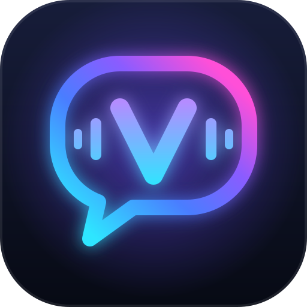

<p align="center"></p>

<h1 align="center">VoxChat</h1>

<p align="center">Party voice chat and messages with your console friends, right from your computer.</p>

> [!IMPORTANT]
> **VoxChat is not an official app.** It is a free, independent project. It is not made, approved or
> supported by any console maker, so they cannot help you with it.

> [!CAUTION]
> ## ⚠️ YOUR ACCOUNT CAN GET BANNED
> Using VoxChat breaks the network's terms of service, and your account
> can be **suspended or permanently banned**. Only use an account you are okay with losing.
> You use this app at your own risk.

> [!WARNING]
> ## 🎮 NEW ACCOUNTS MUST SIGN IN ON A CONSOLE FIRST
> The network keeps party voice chat **turned off** for accounts that have never signed in on a real console.
> If you made a new account for VoxChat, sign in to it **once on a console** first (or ask a friend you trust to).
> Until then, VoxChat shows **"Parties are blocked for this account"** and you can't join or start parties.
> A quick check: if parties work for that account in the official phone app, they work in VoxChat too.

## What it does

- **Party voice chat.** Join a party a friend invites you to, or start your own and invite friends.
- **Messages.** Read your conversations and reply.
- **Friends.** See who is online, answer friend requests, and find players by their Online ID.
- **Profiles.** Look at a player's games and trophies.
- **Several accounts.** Save more than one account and switch between them.

Your friends don't need VoxChat. They stay on their console or phone and hear you like anyone else in the party.

## Download

Get the file for your computer from the [Releases page](https://github.com/ardazafer123/voxchat/releases/latest):

| Computer | File | How to start |
| --- | --- | --- |
| Windows 10/11 | `VoxChat-Windows.zip` | Unzip, open the `VoxChat` folder, double-click `VoxChat.exe` |
| Mac with Apple chip, macOS 13 or newer | `VoxChat-macOS.zip` | Unzip, drag `VoxChat` to Applications, open it |
| Linux (Ubuntu 22.04, Debian 12, Fedora 36 or newer) | `VoxChat-Linux.tar.gz` | Extract, run `VoxChat/VoxChat` |

VoxChat is not signed, so your computer warns you the first time you open it:

- **Windows:** click **More info**, then **Run anyway**.
- **macOS:** right-click the app, choose **Open**, then **Open** again. Or go to System Settings → Privacy & Security and click **Open Anyway**.

Windows and macOS are newer and less tested than Linux. If something doesn't work, please [tell us](#problems).

## First start: add your account

VoxChat signs in with a code from your web browser, called `npsso`. The app shows these steps too.

1. In your browser, sign in to your account on the official website.
2. Open the link shown in VoxChat. The page shows a short line of text with an `npsso` value in it.
3. Copy only the value (the long text between the quotes) and paste it into VoxChat.
4. Tick **I understand the risk for this account**, then click **Sign in**.

> [!WARNING]
> Your `npsso` value works like a password. Anyone who has it can use your account.
> Never share it, and never paste it anywhere except VoxChat.

If VoxChat stops loading your friends or parties after a while, your sign-in has probably expired.
Sign out of that account in VoxChat and add it again with a fresh `npsso`.

## Using voice chat

- **Join:** party invitations show on the **Parties** page. Click one to join. The refresh button checks for new ones.
- **Host:** click **Start a party**, then invite friends from the list.
- **During a call:** the round microphone button mutes you, and **Leave** ends the call for you.
- **Microphone and speakers:** pick them in **Settings** before you join. They can't be changed during a call.

**Closing the window** keeps VoxChat running in the system tray (the menu bar on macOS), so a call keeps going.
It also shows a notification for new party invitations and friend requests. To quit, right-click the tray icon
and choose **Quit VoxChat**. If your desktop has no tray, closing the window quits.

The first time you join, allow microphone access if your computer asks (macOS),
and allow network access if the firewall asks (Windows).

## Your data

- Your sign-ins are saved only on your computer, in a `.config/psclient` folder in your home folder.
  On Windows that is `C:\Users\<your name>\.config\psclient`.
- **Sign out** deletes that account's saved sign-in from your computer.
- Pictures and messages are not saved to disk.
- VoxChat has no tracking and no servers of its own. It only talks to the network's servers,
  plus a public Google server that helps voice chat find a path through your router.
- The downloaded app also asks GitHub every few hours whether a newer VoxChat is out,
  and shows an **Update available** bar when one is. Nothing about you is sent.

## Problems?

- **The app won't open:** see the warnings under [Download](#download).
- **Friends can't hear you:** check the microphone in **Settings**, and check that your computer allows VoxChat to use it.
- **Stuck at "Connecting":** update to the newest version. Older versions had this problem on Windows.
- **Anything else:** open an issue on the [Issues page](https://github.com/ardazafer123/voxchat/issues).
  Say what you did and what went wrong. Never post your `npsso` value or a screenshot that shows it.
  It helps to attach `voxchat.log` from the `.config/psclient` folder. It can show your IP address
  and Online IDs, so remove those first if you don't want them public.

## Install from source

Use this if there is no download for your computer, or you want the newest code.
Works on Windows 10/11, macOS 13 or newer, and Linux (Ubuntu 22.04, Debian 12, Fedora 35 or newer).

1. Install [uv](https://docs.astral.sh/uv/getting-started/installation/). It also gets the right Python for you.
2. On Linux only, install the audio library, for example `sudo apt install libportaudio2`.
3. Download VoxChat and install it. In a terminal:

```bash
git clone https://github.com/ardazafer123/voxchat.git
cd voxchat/client
uv venv --python 3.12
uv pip install --require-hashes -r requirements.lock
```

Then start it:

- **Windows:** double-click `run.bat` in the `client` folder.
- **macOS and Linux:** in the `client` folder, run `bash run.sh`.

On Linux, run `bash install-launcher.sh` once to add VoxChat to your app launcher.

## For developers

Run the tests in the `client` folder:

```bash
uv run python -m unittest discover -s tests -t .
```

To build the downloadable app yourself, run this in the `client` folder: `uv run --with pyinstaller==6.22.3 pyinstaller voxchat.spec`.
The app ends up in `client/dist`.

To try the app with no saved sign-ins, set `PSCLIENT_CONFIG_DIR` to an empty folder before starting it.

## Support VoxChat

VoxChat is free and always will be. If it's useful to you and you'd like to say thanks,
you can leave a tip. It's completely optional and doesn't unlock anything.

<a href="https://ko-fi.com/voxchatapp"></a>

## License

Released under the [MIT License](LICENSE).

VoxChat is not affiliated with, endorsed by or connected to any console maker.
All product names belong to their owners.
